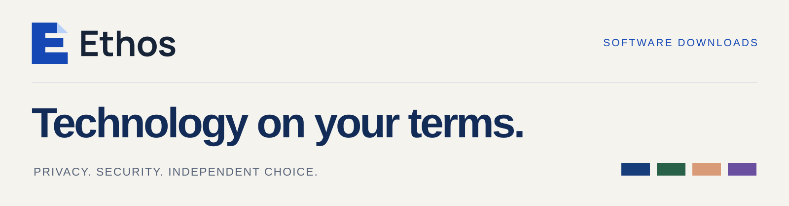

  

  <a href="https://www.ethostechnologies.si"><strong>WEBSITE</strong></a> &nbsp;·&nbsp;
  <a href="#download-ethos"><strong>DOWNLOADS</strong></a> &nbsp;·&nbsp;
  <a href="https://github.com/ssharaf-dot/ethos-releases/releases"><strong>RELEASE NOTES</strong></a> &nbsp;·&nbsp;
  <a href="docs/INSTALLATION.md"><strong>INSTALLATION</strong></a>

Ethos builds free software for your work, your ideas and your digital life. Privacy, security and independent choice guide the company behind it. This is the official download and release hub for the Ethos productivity suite.

## Download Ethos

**Start with Ethos Home.** Choose, install, open and update the apps you want from one place. You can also download each app separately below.

  
  

All downloads are free. These links point to the latest published release. [View every release](https://github.com/ssharaf-dot/ethos-releases/releases) · [Installation guide](docs/INSTALLATION.md) · [SHA-256 checksums](https://github.com/ssharaf-dot/ethos-releases/releases/latest/download/SHA256SUMS.txt)

## A tool for what you’re working on

<table>
<tr>
<td width="50%" valign="top">

<h3> Ethos Docs</h3>

Make space for the next draft. Write and format documents with a compact tools row and an Inspector beside the page.

<a href="https://github.com/ssharaf-dot/ethos-releases/releases/latest/download/Ethos-Docs-macOS.dmg"><strong>macOS ↓</strong></a> &nbsp;·&nbsp; <a href="https://github.com/ssharaf-dot/ethos-releases/releases/latest/download/Ethos-Docs-Windows.msi"><strong>Windows ↓</strong></a> &nbsp;·&nbsp; <a href="https://www.ethostechnologies.si/docs.html">Explore Docs ↗</a>

</td>
<td width="50%" valign="top">

<h3> Ethos Sheets</h3>

Let the numbers tell their story. Work with tables, formulas and charts, with cell formatting close at hand.

<a href="https://github.com/ssharaf-dot/ethos-releases/releases/latest/download/Ethos-Sheets-macOS.dmg"><strong>macOS ↓</strong></a> &nbsp;·&nbsp; <a href="https://github.com/ssharaf-dot/ethos-releases/releases/latest/download/Ethos-Sheets-Windows.msi"><strong>Windows ↓</strong></a> &nbsp;·&nbsp; <a href="https://www.ethostechnologies.si/sheets.html">Explore Sheets ↗</a>

</td>
</tr>
<tr>
<td width="50%" valign="top">

<h3> Ethos Slides</h3>

Give your ideas a place in the room. Build presentations with slide thumbnails, speaker notes and text settings in the Inspector.

<a href="https://github.com/ssharaf-dot/ethos-releases/releases/latest/download/Ethos-Slides-macOS.dmg"><strong>macOS ↓</strong></a> &nbsp;·&nbsp; <a href="https://github.com/ssharaf-dot/ethos-releases/releases/latest/download/Ethos-Slides-Windows.msi"><strong>Windows ↓</strong></a> &nbsp;·&nbsp; <a href="https://www.ethostechnologies.si/slides.html">Explore Slides ↗</a>

</td>
<td width="50%" valign="top">

<h3> Ethos PDF Professional</h3>

Take a closer look at every detail. Read, edit, sign and protect PDFs, with bookmarks beside the page.

<a href="https://github.com/ssharaf-dot/ethos-releases/releases/latest/download/Ethos-PDF-macOS.dmg"><strong>macOS ↓</strong></a> &nbsp;·&nbsp; <a href="https://github.com/ssharaf-dot/ethos-releases/releases/latest/download/Ethos-PDF-Windows.msi"><strong>Windows ↓</strong></a> &nbsp;·&nbsp; <a href="https://www.ethostechnologies.si/pdf.html">Explore PDF ↗</a>

</td>
</tr>
</table>

## Why Ethos exists

Useful technology should leave people with choices. Ethos is an attempt to make practical alternatives available beyond an ecosystem controlled by a few providers.

- **Privacy as a starting point.** Minimise unnecessary data collection and make data practices understandable.
- **Security as a responsibility.** Give care to how tools are built, maintained and explained.
- **Openness and participation.** Make room for scrutiny, learning and improvements through open source.
- **Independent choice.** Help people choose tools that fit their own work and values.

These are the principles guiding Ethos. [Read our ethos](https://www.ethostechnologies.si/about.html).

## Before you install

| Platform | Available build | Installation |
|---|---|---|
| macOS | Apple Silicon · macOS 11 or later | Open the DMG and move the app to Applications. |
| Windows | 64-bit (x64) | Run the MSI. It installs for the current user without administrator rights. |

Current preview builds are not yet signed/notarized by Apple or signed with a Windows certificate. See the [installation guide](docs/INSTALLATION.md) for first-launch steps. Ethos Home checks apps against their published SHA-256 before installing them.

## What’s next

**Disk Cleaner and Disk Wipe are in development.** Downloads, supported systems and documented capabilities will be published when ready. [Follow releases](https://github.com/ssharaf-dot/ethos-releases/releases).

---

**ETHOS TECHNOLOGIES** · [WEBSITE](https://www.ethostechnologies.si) · [RELEASE NOTES](https://github.com/ssharaf-dot/ethos-releases/releases) · [CREDITS & LICENSING](CREDITS.md)
